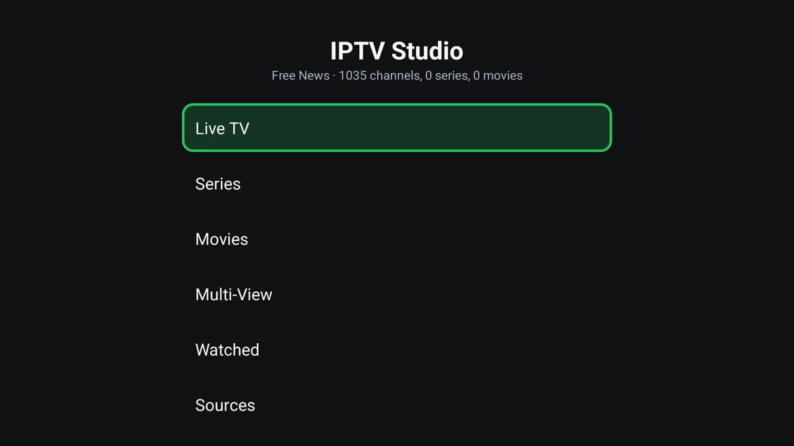
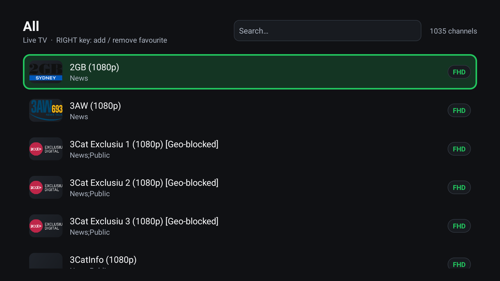
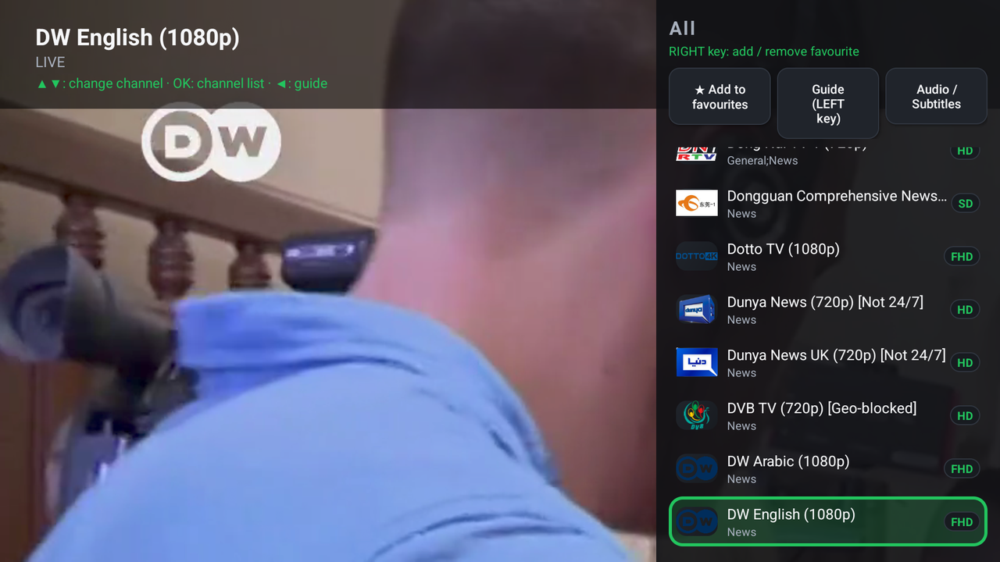
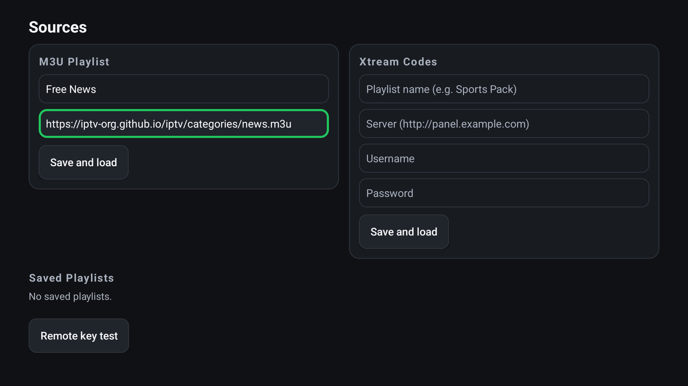

# IPTV Studio

An IPTV player for Android TV and TV boxes, built to be used comfortably with a remote.

## ⬇️ Download

**[IPTV-Studio.apk](https://github.com/canmurat5734-netizen/iptv-studio/releases/latest/download/IPTV-Studio.apk)**

This link always downloads the latest version.

> ⚠️ **No channels or streams are included.** IPTV Studio is only a player. You need the
> M3U link or Xtream login of your own IPTV subscription to use it.

## Screenshots

| | |
|---|---|
|  |  |
|  |  |

Screenshots use the free public news channels from [iptv-org](https://github.com/iptv-org/iptv).

## Features

- Live TV, Movies, Series (seasons and episodes)
- **Xtream Codes** and **M3U / M3U Plus** support
- Continue watching and watch history
- Favourites (**RIGHT arrow** or the **red button** on the remote)
- 2x2 multi-view (4 channels at once)
- Audio and subtitle track selection (**MENU** button)
- Hardware-accelerated playback (ExoPlayer), smooth even on budget TV boxes
- Android 5.0 and up
- English and Turkish interface (follows your device language)

## Installing on your TV

**Option 1: With the Downloader app (easiest)**
1. Install **Downloader** from the Play Store on your TV.
2. Open it and enter the download link above.
3. Install the downloaded file. Allow installs from unknown sources if asked.

**Option 2: With a USB stick**
1. Download the APK on your computer and copy it to a USB stick.
2. Plug the stick into your TV and open the APK with a file manager to install it.

## First launch

1. Go to **Sources** in the app.
2. Enter either your M3U link or your Xtream details (server, username, password).
3. Once the channels have loaded, start watching from **Live TV / Movies / Series**.

Your details are stored only on your own device and are used only to connect to your own
IPTV server. The app does not send data anywhere else.

## Updating

When a new version is released, download it from the same link and install it over the old
one. Your settings, favourites and history are kept.
